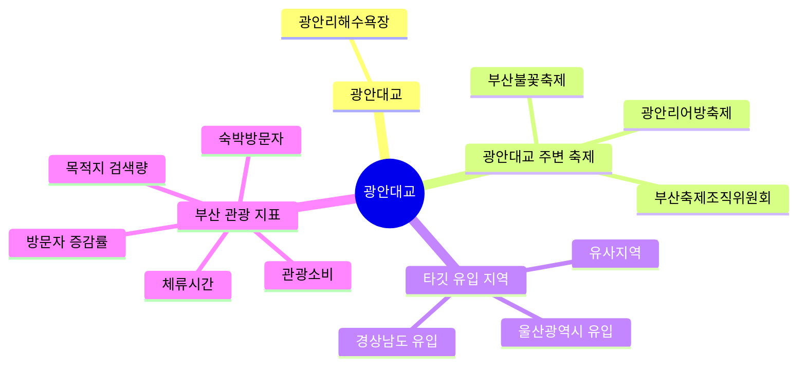

# 부산 지역 키워드 맵 · 김이지 · AX 데이터·서비스 트랙

> 키워드 하나 = 리서치 노트 하나. 노트를 만들면 '노트' 칸에 파일 이름을 적습니다.
> 출처를 확인하지 못한 키워드는 '상태'에 `확인 필요`로 둡니다.
> 키워드는 12개 이상 채웁니다.

## 가운데 질문

부산의 상징 광안대교를 한 장으로 정리하려면, 경남·울산에서 오는 20~40대에게 어떤 행사와 숫자를 보여 줘야 할까?

## 키워드 표

| 묶음 | 분류 | 키워드 | 왜 골랐나 (크리에이티브: 장면 한 줄 / 데이터·서비스: 셀 수 있는 것·숫자·분모 열) | 근거 (inputs 파일 엑셀 행 또는 URL, 확인일) | 노트 | 상태 |
|---|---|---|---|---|---|---|
| 광안대교 | ? | 광안대교 | 기획 목적의 중심. inputs 6개 파일에는 '광안대교'라는 글자가 없어 웹 페이지로 확인. 비짓부산 페이지 원문: "광안대교라는 랜드마크와 함께 부산을 대표하는 해수욕장 중 하나로 꼽히는 광안리 해수욕장." 페이지에 적힌 주소 "부산광역시 수영구 광안해변로 219"는 busan_festivals.csv 엑셀 44행 `소재지도로명주소`와 같음 | 비짓부산(VISIT BUSAN) 명소 페이지 https://www.visitbusan.net/en/index.do?menuCd=DOM_000000201001001000&uc_seq=377&lang_cd=ko (직접 열어 확인, 2026-11-12) |  | 확인함 |
| 광안대교 | 자연 (부: 문화) | 광안리해수욕장 | 셀 수 있는 것: 2026년 축제 중 개최장소에 '광안'이 들어간 행 수 = 2 (18행, 44행). 분모 열: `개최장소` | busan_festivals.csv 엑셀 18행, 44행 (2026-11-12) |  | 확인함 |
| 광안대교 주변 축제 | 문화 | 부산불꽃축제 | 셀 수 있는 것: 개최일 수 = 1일 (`축제시작일자` 2026-11-07, `축제종료일자` 2026-11-07). 개최장소 광안리해수욕장 | busan_festivals.csv 엑셀 44행 (2026-11-12) |  | 확인함 |
| 광안대교 주변 축제 | 문화 (부: 역사) | 광안리어방축제 | 셀 수 있는 것: 2026-06-12 ~ 2026-06-14, `축제내용`에 적힌 "43개 프로그램". 개최장소 광안리해변 및 수영사적공원 일원 | busan_festivals.csv 엑셀 18행 (2026-11-12) |  | 확인함 |
| 광안대교 주변 축제 | 커뮤니티 (부: 문화) | (사)부산축제조직위원회 | 셀 수 있는 것: `주관기관명`이 '(사)부산축제조직위원회'인 행 = 7 (12·16·19·21·27·44·46행). 부산불꽃축제(44행)의 주관기관. 분모 열: `주관기관명` | busan_festivals.csv 엑셀 12, 16, 19, 21, 27, 44, 46행 (2026-11-12) |  | 확인함 |
| 타깃 유입 지역 | 산업 | 경상남도 유입 | 숫자: `유입유출 비율` 64.9 (`유입유출구분` 유입). 분모가 무엇인지는 파일에 없음 | datalab_related_regions.csv 엑셀 2행 (2026-11-12) |  | 확인함 |
| 타깃 유입 지역 | 산업 | 울산광역시 유입 | 숫자: `유입유출 비율` 15.4 (`유입유출구분` 유입). 분모가 무엇인지는 파일에 없음 | datalab_related_regions.csv 엑셀 3행 (2026-11-12) |  | 확인함 |
| 타깃 유입 지역 | ? | 유사지역 (울산·서울·대구) | 셀 수 있는 것: 부산과 묶인 지역 3곳, `기준지역명` 칸에 울산광역시·서울특별시·대구광역시. 왜 비슷한지 기준은 파일에 없음 | datalab_similar_regions.csv 엑셀 2~4행 (2026-11-12) |  | 확인함 |
| 부산 관광 지표 | 산업 | 방문자 증감률 | 숫자 두 개가 다름: `광역지자체 증감률` 0.8 / `지표 증감률`(방문자유입) 0.9. 같은 지표인지 알 수 없어 둘 다 적음 | datalab_visitors.csv 엑셀 2행, datalab_diagnosis.csv 엑셀 2행 (2026-11-12) |  | 확인함 |
| 부산 관광 지표 | 산업 | 숙박방문자 | 숫자: `지표 증감률`(숙박방문자 비율) -1.2 / `숙박방문자 증감률` -1.2. 칸 이름이 서로 다름 | datalab_diagnosis.csv 엑셀 3행, datalab_stay.csv 엑셀 2행 (2026-11-12) |  | 확인함 |
| 부산 관광 지표 | 산업 | 체류시간 | 숫자: `지표 증감률`(체류시간) -3.2 / `체류시간 증감률` -3.2 | datalab_diagnosis.csv 엑셀 4행, datalab_stay.csv 엑셀 2행 (2026-11-12) |  | 확인함 |
| 부산 관광 지표 | 산업 | 목적지 검색량 | 숫자: `지표 증감률`(목적지 검색량) -5.8 | datalab_diagnosis.csv 엑셀 5행 (2026-11-12) |  | 확인함 |
| 부산 관광 지표 | 산업 | 관광소비 | 숫자: `지표 증감률`(관광소비) 9.0 | datalab_diagnosis.csv 엑셀 6행 (2026-11-12) |  | 확인함 |

### 분류 까닭

- 광안대교: ? — 6개 분류에 다리·교통 시설이 들어갈 칸이 없음. 근거 원문에는 "랜드마크"라는 말만 있어 문화로 볼지 산업(교통 기반 시설)으로 볼지 정할 자료가 모자람
- 광안리해수욕장: 자연 — 바다와 모래사장이 있는 해수욕장. 부: 문화 — 축제 두 개(18·44행)가 열리는 곳
- 부산불꽃축제: 문화 — 하루 동안 열리는 축제 행사(44행)
- 광안리어방축제: 문화 — 축제 행사(18행). 부: 역사 — 개최장소에 '수영사적공원'이 들어 있음
- (사)부산축제조직위원회: 커뮤니티 — 사람이 모여 만든 사단법인(단체). 부: 문화 — 축제 7개를 주관함
- 경상남도 유입: 산업 — 부산 관광에 손님이 어디서 오는지 보여 주는 관광 시장 숫자(64.9)
- 울산광역시 유입: 산업 — 경상남도 유입과 같은 관광 시장 숫자(15.4)
- 유사지역 (울산·서울·대구): ? — 파일에 왜 비슷한 지역으로 묶였는지 기준이 없어 어느 분류인지 판단할 자료가 모자람
- 방문자 증감률: 산업 — 관광객 수 변화를 보여 주는 관광 시장 지표
- 숙박방문자: 산업 — 숙박업과 바로 이어지는 관광 시장 지표
- 체류시간: 산업 — 관광객이 머무는 시간을 보여 주는 관광 시장 지표
- 목적지 검색량: 산업 — 관광 수요(찾아보는 사람 수)의 변화를 보여 주는 지표
- 관광소비: 산업 — 관광객이 쓴 돈을 보여 주는 지표(+9.0)

### 묶음 예시

- **AX 크리에이티브 트랙:** 설화·스토리 / 인물 / 캐릭터·IP / 장소·관광 / 축제·행사
- **AX 데이터·서비스 트랙:** 특산물 / 로스터리·양조장 / 전통시장 / 상권 / 물류 거점(항만)

## 키워드 사이 연결 (선택)

## 뺀 것

| 뺀 행·키워드 | 이유 |
|---|---|
| busan_festivals.csv 엑셀 3행 장림항 부네치아 아트프리마켓 | 종료일이 2025년인 축제 (`축제종료일자` 2025-10-19) |
| busan_festivals.csv 엑셀 4행 감천문화마을 골목축제 | 종료일이 2025년인 축제 (`축제종료일자` 2025-10-25) |
| busan_festivals.csv 엑셀 5행 제28회 UN평화축제 | 종료일이 2025년인 축제 (`축제종료일자` 2025-10-26) |
| busan_festivals.csv 엑셀 15행 해운대모래축제 | 한국관광공사가 올린 중복 행 (13행 2026 제21회 해운대 모래축제와 날짜·장소 겹침) |
| busan_festivals.csv 엑셀 17행 광안리어방축제 | 한국관광공사가 올린 중복 행 (18행 제24회광안리어방축제와 날짜·장소 같음, 18행을 남김) |
| busan_festivals.csv 엑셀 28행 부산국제록페스티벌 | 한국관광공사가 올린 중복 행 (27행과 축제명 같음) |
| busan_festivals.csv 엑셀 32행 동래읍성역사축제 | 한국관광공사가 올린 중복 행 (33행과 축제명 같음) |
