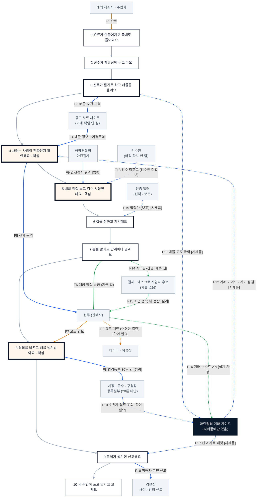

# 밸류체인 지도 v0 (내 첫 지도) · 마린딜러 (중고 요트 거래)

- 확인한 날짜: 2026-11-25
- 읽은 파일: `valuechain/steps.md`(단계 10개), `valuechain/flows.md`(화살표 F1~F19). 두 파일에 없는 단계·화살표·회사는 넣지 않았다.
- 그림: `valuechain/map.html` (브라우저로 연다)
- 읽는 법: 회색 = 단계 순서 · **파랑 = 데이터** · **초록 = 돈** · **주황 = 물건** · 점선 = 근거 없음 또는 아직 실제로 만들지 않음 (시제품에만 있음 · 제휴 전 · 설계 가정) [확인 필요] · 굵은 테두리 = 우리 팀이 닿는 단계(3·6·7·9) · **가장 굵은 테두리 + 연한 주황 = 핵심(4·5·8, 거래 가이드가 닿는 자리)** · 남색 = 마린딜러
- 기획의도: 중심은 입찰이 아니라 **거래 가이드**다. 역경매(F19)는 보조로 점선 처리했다.

## Mermaid 원문

## 한눈에 보기

- **지금 길 (실선):** 선주가 중고 보트 사이트에 매물을 올리고(F3) → 매수인이 보고(F4) → 전화로 묻고(F5) → 대금을 선주에게 직접 보낸다(F6). 사이트는 "거래에 대해서는 책임을 지지 않습니다"(`steps.md` 6단계 근거). 법으로 정해진 길은 안전검사(F9, 해양경찰청)와 30일 안 변경등록(F8)뿐이다.
- **바꾸려는 길 (점선, 아직 없음):** 마린딜러 거래 가이드가 매수인에게 사기 전 확인을 알려 주고(F12), 등록원부로 소유자·압류를 확인하게 하고(F10), 검수 리포트를 붙이고(F13), 돈은 제휴 사업자에게 맡겼다가 조건이 채워지면 넘긴다(F14·F15). 문제가 생기면 신고 자료를 묶어 준다(F17).
- **비어 있는 곳:** 10단계(새 주인이 쓰고 고쳐요)로 가는 화살표는 근거가 없다. 매수인이 우리에게 돈을 내는 화살표도 없다(A안: 매수인 0원). 부산 요트 척수·거래 건수가 없어 양은 그리지 않았다.

## 우리 팀이 닿는 단계

| 단계 | 우리가 하는 일 | 화살표 |
|---|---|---|
| 3 선주가 팔기로 하고 매물을 올려요 | 판매자 가이드 · 매물·고지 확약 받기 | F11 |
| **4 사려는 사람이 진짜인지 확인해요 (핵심)** | 사기 전 확인 가이드 · 사진 재사용·명의 불일치·저가 점검 · 등록원부 조회 안내 | F10 · F12 |
| **5 배를 직접 보고 검수·시운전해요 (핵심)** | 검수 체크리스트 · 검수 리포트 · 법정 안전검사 확인 안내 | F9 · F13 |
| 6 값을 정하고 계약해요 | 시세 범위 · 계약 전 확인 · 역경매는 보조 | F19 |
| 7 돈을 맡기고 단계마다 넘겨요 | 에스크로 4단계 설계 (제휴 전) | F14 · F15 · F16 |
| **8 명의를 바꾸고 배를 넘겨받아요 (핵심)** | 30일 안 변경등록 · 20톤 기준 기관 안내 | F7 · F8 |
| 9 문제가 생기면 신고해요 | 신고 자료 패킷 (신고는 피해자 본인) | F17 · F18 |
