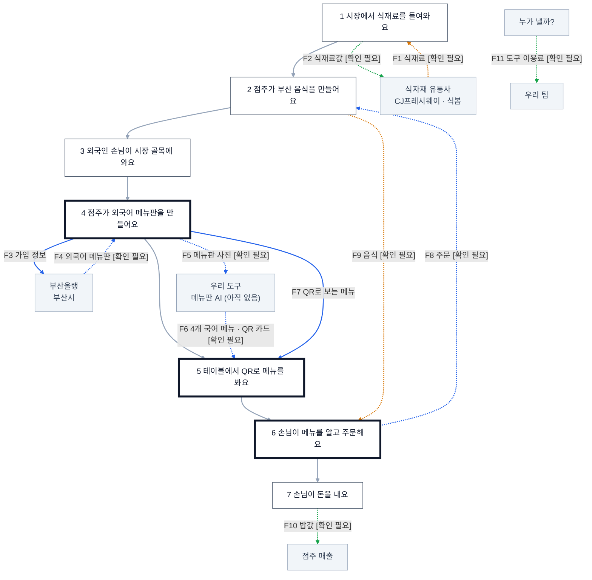

# 밸류체인 지도 v0 (내 첫 지도) · 부산 식당 다국어 메뉴판 AI

- 확인한 날짜: 2026-11-24
- 읽은 파일: `valuechain/steps.md`(단계 7개), `valuechain/flows.md`(화살표 F1~F11). 두 파일에 없는 단계·화살표·회사는 넣지 않았다.
- 그림: `valuechain/map.html` (브라우저로 연다)
- 읽는 법: 회색 = 단계 순서 · **파랑 = 데이터** · **초록 = 돈** · **주황 = 물건** · 점선 = 근거 없음 [확인 필요] · 굵은 테두리 = 우리 팀이 닿는 단계(4·5·6)

## Mermaid 원문

## 화살표마다 근거 (flows.md에서 그대로)

| 화살표 | 종류 | 선 | 근거 |
|---|---|---|---|
| F1 식재료 | 물건 | 점선 | `industry/one-page.md:17` 회사는 외식 사업자에게 판다. 우리 점주가 사는지는 [확인 필요] |
| F2 식재료값 | 돈 | 점선 | F1과 같음 |
| F3 가입 정보 | 데이터 | 실선 | 검증 노트:26 "'부산올랭'에 가입한 2522개 음식점" |
| F4 외국어 메뉴판 | 데이터 | 점선 | 검증 노트:46 "가입을 하더라도 외국어 메뉴판 제작 등 활용은 어렵다." |
| F5 메뉴판 사진 | 데이터 | 점선 | `LOCAL.md:9` 첫 판 [제안], 아직 없음 |
| F6 4개 국어 메뉴 · QR 카드 | 데이터 · 물건 | 점선 | `LOCAL.md:9` 첫 판 [제안], 아직 없음 |
| F7 QR로 보는 메뉴 | 데이터 | 실선 | 검증 노트:27 "조사 대상 음식점 중 34.8%만 이를 비치했다." |
| F8 주문 | 데이터 | 점선 | `painpoint.md:17` P3 [확인 필요] |
| F9 음식 | 물건 | 점선 | `steps.md:12` 2단계 근거 없음 |
| F10 밥값 | 돈 | 점선 | `steps.md:17` 결제 방식 [확인 필요] |
| F11 도구 이용료 | 돈 | 점선 | `steps.md:29`~`32` 누가 낼지 정하지 않음 (가설) |

- 검증 노트 = `research/2026-11-24-주제후보-제미나이-검증.md`
- 넣고 싶었지만 뺀 것: 손님 리뷰·재방문 (steps.md에 단계가 없음), 크루즈 승객 (확장 후보, steps.md에 없음)

## 체크리스트 넷 (사람이 map.html을 열어 보고 적기)

- [ ] 1. 화살표마다 근거가 있나? (위 근거 표에서 빈 줄이 없는지)
- [ ] 2. 단계 이름이 손님이 알아듣는 말인가?
- [ ] 3. 파랑(데이터) 화살표가 하나 이상 있고, 데이터가 처음 생기는 단계에서 출발하나?
- [ ] 4. 굵은 테두리가 steps.md에서 '예'라고 한 단계(4·5·6)와 같은가?

본 것 (한 줄씩 적기):
-
