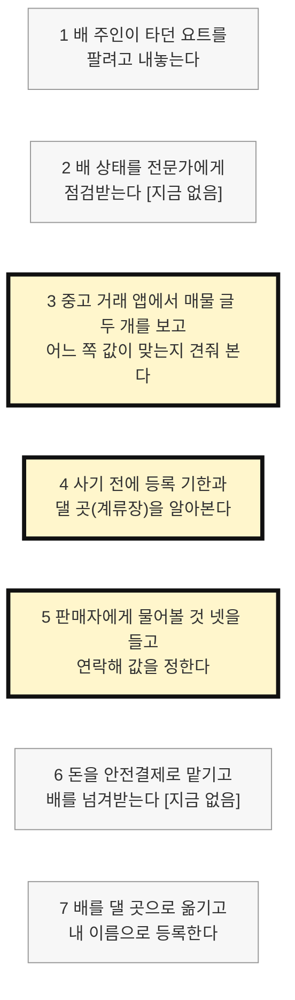
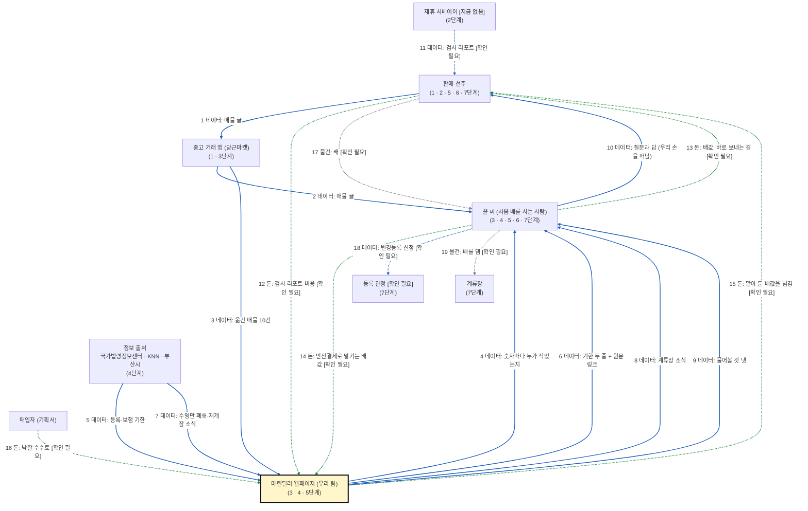

# map · 마린딜러 밸류체인 첫 지도 (10일차 3교시)

- 작성: 2026-11-26 · Claude 초안 (첫 지도). **Claude는 이 그림이 실제로 어떻게 그려지는지 보지 못했습니다.** `map.html`을 브라우저로 열어 확인해 주세요.
- 읽은 파일: `yujin/valuechain/steps.md`, `yujin/valuechain/flows.md`
- 세 가지 항목
  - 기획 목적: 단계와 화살표를 한 장의 지도로 그려, 사람이 틀린 곳을 찾기 쉽게 한다
  - 우선순위: `steps.md`와 `flows.md`에 있는 것만 그리기. 근거 없는 화살표는 점선
  - 대상 / 제외: 우리 팀 팀원 / 두 파일에 없는 단계 · 화살표 · 회사를 새로 넣기
- 그림 규칙: 물건 = 회색 · 돈 = 초록 · 데이터 = 파랑 · 점선 = 근거 없음, 이름 뒤 [확인 필요] · 굵은 테두리 = 우리 팀이 닿는 단계(3 · 4 · 5)
- 그림은 둘입니다. **그림 1**은 단계 7개를 순서대로 놓은 띠, **그림 2**는 이해관계자 사이의 화살표 19개입니다. 그림 1의 단계 사이에는 화살표가 없습니다 (아래 '넣고 싶었던 것' 1번).

## 그림 1 · 단계 (Mermaid 원문)

## 그림 2 · 화살표 (Mermaid 원문)

- `linkStyle`의 숫자는 0부터 셉니다. 화살표 1번 = 0, 19번 = 18입니다.
- 둘째 판 (2026-11-26, yujin이 본 것으로 고침): 맨 위 `config`로 네모 · 층 간격을 넓힘. 같은 두 네모 사이 선의 길이를 다르게 함(`--->`, `---->`, `----->`, `-...->`)으로 7 · 6 · 8 · 9 · 14번 라벨이 위아래로 엇갈리게 함. `map.html`에서는 라벨 뒤에 흰 바탕과 테두리를 넣음. 단계 · 화살표 · 번호 · 색은 바꾸지 않음.

## 근거 표 (flows.md 번호 그대로)

| 번호 | 어디서 → 어디로 | 무엇이 | 선 | 근거 (flows.md에서 옮김) |
|---:|---|---|---|---|
| 1 | 판매 선주 → 중고 거래 앱 | 데이터: 매물 글 | 실선 | `story/storyboard.md:29` "가격 → "판매자가 적은 값이에요"" |
| 2 | 중고 거래 앱 → 윤 씨 | 데이터: 매물 글 | 실선 | `story/storyboard.md:29` "yujin이 2026-11-25에 옮긴 당근마켓 매물 10건" |
| 3 | 중고 거래 앱 → 마린딜러 | 데이터: 옮긴 매물 10건 | 실선 | `story/storyboard.md:29` "yujin이 2026-11-25에 옮긴 당근마켓 매물 10건 가운데" |
| 4 | 마린딜러 → 윤 씨 | 데이터: 숫자마다 누가 적었는지 | 실선 | `story/storyboard.md:29` "사용시간을 숫자로 적은 글은 0건이었어요." |
| 5 | 정보 출처 → 마린딜러 | 데이터: 등록 · 보험 기한 | 실선 | `story/storyboard.md:30` "법령 사본에서 읽은 값이에요. 공식 본문과 맞춰 보기 전이에요." |
| 6 | 마린딜러 → 윤 씨 | 데이터: 기한 두 줄 + 원문 링크 | 실선 | `story/storyboard.md:30` "변경등록 기한은 사신 날부터 30일로 읽혀요." |
| 7 | 정보 출처 → 마린딜러 | 데이터: 수영만 소식 | 실선 | `story/storyboard.md:31` "KNN 보도에 따르면, 재개발 실시계획 승인에 따라 전면 폐쇄됐어요." |
| 8 | 마린딜러 → 윤 씨 | 데이터: 계류장 소식 | 실선 | `story/storyboard.md:31` "수영만 요트경기장은 지금 닫혀 있어요" |
| 9 | 마린딜러 → 윤 씨 | 데이터: 물어볼 것 넷 | 실선 | `story/storyboard.md:32` "판매자에게 물어볼 것 넷" |
| 10 | 윤 씨 → 판매 선주 | 데이터: 질문과 답 | 실선 (우리 손을 떠남) | `story/storyboard.md:34` "물어볼 것 넷을 들고 판매자에게 연락해 보세요." |
| 11 | 제휴 서베이어 → 판매 선주 | 데이터: 검사 리포트 | 점선 [확인 필요] | `yujin/busan_used_yacht_platform_plan.md:69` [지금 없음] |
| 12 | 판매 선주 → 마린딜러 | 돈: 검사 리포트 비용 | 점선 [확인 필요] | `yujin/busan_used_yacht_platform_plan.md:85` [지금 없음] |
| 13 | 윤 씨 → 판매 선주 | 돈: 배값 (바로) | 점선 [확인 필요] | [확인 필요] · 확인할 곳: 당근마켓 이용 안내 + 팀 결정 |
| 14 | 윤 씨 → 마린딜러 | 돈: 안전결제로 맡기는 배값 | 점선 [확인 필요] | `LOCAL.md:3` "안전결제는 아직 [지금 없음]" |
| 15 | 마린딜러 → 판매 선주 | 돈: 맡아 둔 배값을 넘김 | 점선 [확인 필요] | `yujin/busan_used_yacht_platform_plan.md:71` [지금 없음] |
| 16 | 매입자 → 마린딜러 | 돈: 낙찰 수수료 | 점선 [확인 필요] | `yujin/busan_used_yacht_platform_plan.md:84` [지금 없음] |
| 17 | 판매 선주 → 윤 씨 | 물건: 배 | 점선 [확인 필요] | `yujin/busan_used_yacht_platform_plan.md:71` [지금 없음] |
| 18 | 윤 씨 → 등록 관청 | 데이터: 변경등록 신청 | 점선 [확인 필요] | `yujin/busan_used_yacht_platform_plan.md:50` |
| 19 | 윤 씨 → 계류장 | 물건: 배를 댐 | 점선 [확인 필요] | `story/storyboard.md:31` "지금 들어갈 수 있는 계류지 목록이 없음" |

- 개수: 19개 (실선 10 · 점선 9). 데이터 12 (파랑) · 돈 5 (초록) · 물건 2 (회색). `flows.md`와 같습니다.

## 넣고 싶었던 것 (그리지 않음)

1. **단계 사이 화살표 (1 → 2 → … → 7)**: 순서는 `steps.md`에 있지만 화살표로는 `flows.md`에 없습니다. 그림 1은 보이지 않는 연결(`~~~`)로 순서만 위에서 아래로 놓았습니다.
2. **보험사**: `flows.md`의 '뺀 것'에 보험료가 있어 이해관계자로 그리지 않았습니다.
3. **이해관계자와 단계를 잇는 선**: 어느 이해관계자가 어느 단계에 있는지는 네모 안 괄호 글로만 적었습니다.

## 체크리스트 메모 (yujin이 열어 보고 적음)

| # | 확인 | 결과 · 본 것 |
|---|---|---|
| 1 | 화살표마다 근거가 있나 (위 근거 표) | 통과 · 근거 표 19줄에 빈칸 없음 (Claude 확인) |
| 2 | 단계 이름을 누구나 읽고 알아들을 수 있나 | 통과 · 그림 1의 7단계 이름이 잘리지 않고 읽힘 (yujin, 둘째 판) |
| 3 | 파란 데이터 화살표가 하나 이상 보이나 | 걸림 (첫 지도): 9번 "데이터: 물어볼 것 넷"이 초록 점선이라 돈 화살표처럼 보임 — 원문은 파란 실선. 14번(초록 점선)과 겹쳐 보인 것으로 추측 → 통과 (둘째 판): 9번이 파란 선에 붙어 보임 (yujin) |
| 4 | 굵은 테두리 단계가 3 · 4 · 5와 같나 | 통과 · 굵은 테두리 노란 칸이 3 · 4 · 5단계 (yujin, 둘째 판) |

- 본 것 (첫 지도, yujin): 웹페이지 노드 위쪽에 5 · 7번 라벨이 붙어 있고, 14 · 16 · 4 · 6 · 8번 라벨이 선과 겹침 → 둘째 판에서 간격을 띄움 → 다시 열어 보니 잘 고쳐짐 (yujin, 2026-11-26)

- 체크리스트 넷 모두 통과 (둘째 판, 2026-11-26)

## 체크리스트 메모 (팀원)
| # | 확인 | 결과 · 본 것 |
|---|---|---|
| 1 | 화살표마다 근거가 있나 (위 근거 표) | 통과 · 김혜선 |
| 2 | 단계 이름을 누구나 읽고 알아들을 수 있나 | 통과 · 김이지 |
| 3 | 파란 데이터 화살표가 하나 이상 보이나 | 통과 · 김혜선 |
| 4 | 굵은 테두리 단계가 3 · 4 · 5와 빨간 테두리 3단계 | 통과 · 전태환 |

- 위 "체크리스트 메모 (팀원)" 표는 팀 지도 점검이라 맨 위 `valuechain/map.md`의 "체크리스트 · 팀 판 점검" 표로 옮겨 적음 (2026-11-26)
